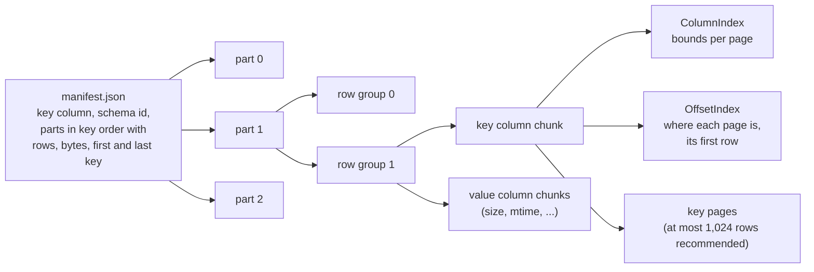
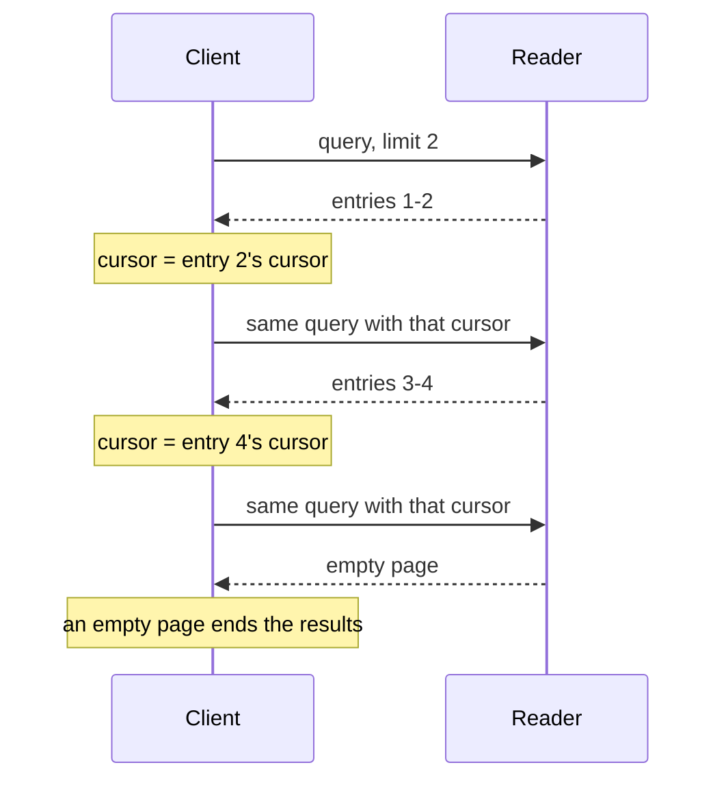
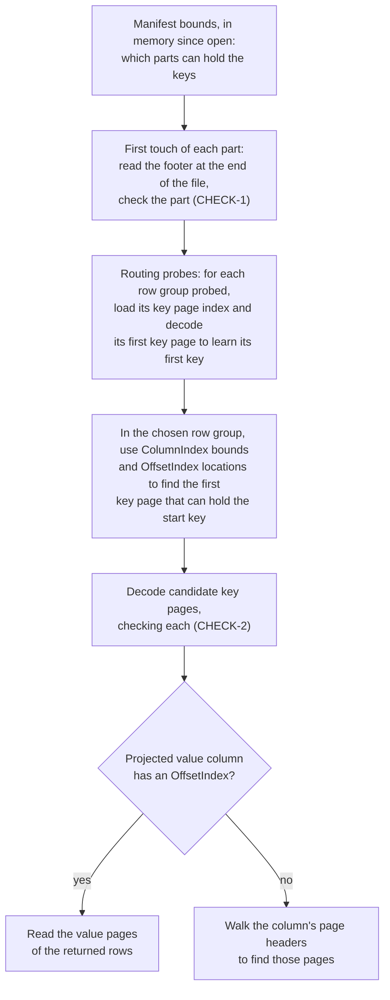
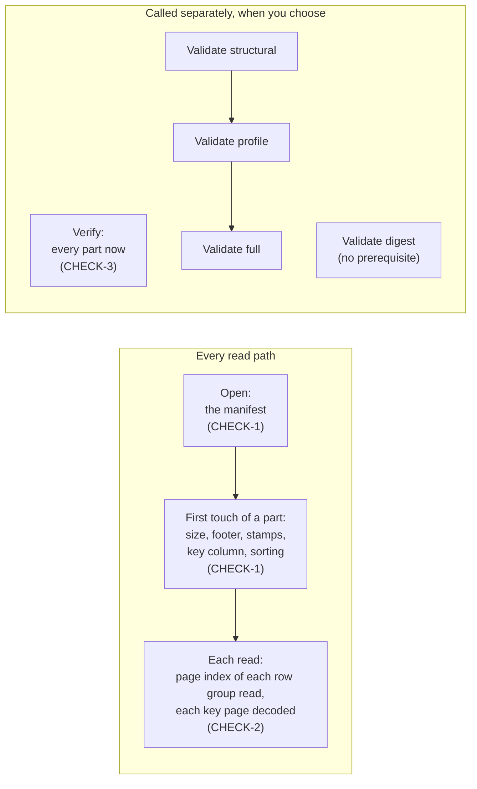

# Concepts

This page explains the model behind SeekParquet: what a dataset is, what a query returns, how a reader finds
rows, and what it checks. Every other page links here for its terms. The [specification](../spec/format-1.md)
is the normative text; this page summarizes its rules and cites their requirement IDs.

Statements are of three kinds, and the page says which:

- **Format rules** come from the specification and cite a requirement ID. Every valid dataset and every
  conforming reader obeys them.
- **Implementation behavior** is what the Go and Java readers in this repository do today. Another reader,
  or a later version, may differ.
- **Recommendations** are advice the specification gives with SHOULD, or this documentation gives on its own.

## A dataset in one picture

A **dataset** is a directory, or an object-store prefix, that holds a `manifest.json` and the Parquet files
the manifest lists ([LAYOUT-1](../spec/format-1.md#layout-1)). Those files are the dataset's **parts**. Every
part is an ordinary Parquet file ([§5](../spec/format-1.md#5-part-files)), so other Parquet readers can read
its rows as a table.

The format rules that make this a SeekParquet dataset and not just a set of Parquet files:

- One **key column**, a byte string named by the manifest, sorts every row of the dataset in unsigned byte
  order: within pages, across pages, row groups and parts ([KEY-3](../spec/format-1.md#key-3)).
- The parts are **key-disjoint** and listed in key order, each with its exact first and last key
  ([PART-3](../spec/format-1.md#part-3), [PART-4](../spec/format-1.md#part-4)), row count and size
  ([§3.3](../spec/format-1.md#33-parts)).
- In every non-empty row group, the key column has a **page index**: a ColumnIndex (bounds per page) and an
  OffsetIndex (location and first row per page) ([RG-2](../spec/format-1.md#rg-2)). Empty row groups may
  appear and are ignored ([§5.2](../spec/format-1.md#52-row-groups-and-the-page-index)).
- Each part's footer carries `seekparquet.*` **stamps** that repeat the manifest's version, schema id and key
  declaration ([STAMP-1](../spec/format-1.md#stamp-1)).
- The manifest is the **commit**: the parts are complete and durable before it is published, it is published
  atomically, and the parts it lists are not modified while it may be read
  ([COMMIT-1](../spec/format-1.md#commit-1), [COMMIT-2](../spec/format-1.md#commit-2)). A dataset is one
  immutable snapshot ([COMMIT-3](../spec/format-1.md#commit-3)).

Columns other than the key are yours: their names, types and meaning belong to the producer, identified by
the manifest's `schema_id` ([COL-1](../spec/format-1.md#col-1)). A part may lack a column that other parts
have ([COL-2](../spec/format-1.md#col-2)).

Recommendation: key pages of at most 1,024 rows ([GEO-1](../spec/format-1.md#geo-1)). Readers accept any page
size.

## Keys and order

A **key** is a non-empty byte string ([KEY-2](../spec/format-1.md#key-2)). Keys compare byte by byte as
unsigned integers from 0 to 255, and a key that is a proper prefix of another sorts first
([§1](../spec/format-1.md#1-conventions)). Keys need not be UTF-8 unless the column is annotated STRING
or legacy UTF8 ([KEY-6](../spec/format-1.md#key-6)). This is the order of `bytes` in Python,
`bytes.Compare` in Go and `Arrays.compareUnsigned` in Java. It is not the order of a string collation, a
locale, or UTF-16 code units.

The manifest declares whether keys are **unique**. With **repeated keys**, consecutive rows with equal keys
form a **key group**. A key group is in file order, chosen by the producer; it may span pages and row
groups, and never spans parts ([KEY-7](../spec/format-1.md#key-7)). Each row has an **offset**: its
zero-based position in its whole key group, always 0 when keys are unique ([PAGE-1](../spec/format-1.md#page-1)).

The **successor** of a prefix `p` is the least byte string greater than every key that begins with `p`. For
`logs/` it is `logs0`. An empty prefix, or one of only `0xFF` bytes, has no successor.

## Queries

The specification defines what a query returns, independent of how a reader finds it
([§6](../spec/format-1.md#6-queries)). Take a dataset with these keys:

| Key |
|---|
| `logs/2026/01/a.gz` |
| `logs/2026/01/b.gz` |
| `logs/2026/02/a.gz` |
| `logs/readme` |
| `photos/cat.jpg` |

| Query | Arguments | Result |
|---|---|---|
| **Range read** ([RANGE-1](../spec/format-1.md#range-1)) | start `logs/2026/01/b.gz` (inclusive), end `photos/` (exclusive) | rows `logs/2026/01/b.gz`, `logs/2026/02/a.gz`, `logs/readme` |
| **Prefix read** | prefix `logs/2026/` | rows `logs/2026/01/a.gz`, `logs/2026/01/b.gz`, `logs/2026/02/a.gz` |
| **Lookup** | key `logs/readme` | the key group of `logs/readme`: one row |
| **Delimited listing** ([LIST-2](../spec/format-1.md#list-2), [LIST-3](../spec/format-1.md#list-3)) | prefix `logs/`, delimiter `/` | common prefix `logs/2026/`, row `logs/readme` |

A range read returns rows in key order, at most a **result limit** of them. Its bounds include or exclude
whole key groups; the result limit may split one. A prefix read is a range read bounded by the prefix and its
successor. A lookup is a range read from a key to that key followed by a `0x00` byte: exactly its key group
([§6.2](../spec/format-1.md#62-range)).

A **delimited listing** works like listing an S3 bucket with a delimiter. Each **candidate row**, a row under
the prefix, before the end bound and after the cursor, becomes either a **row entry**, or, when the rest of its key contains the
delimiter, the **common prefix** up to and including that delimiter. Common prefixes appear once each
([LIST-4](../spec/format-1.md#list-4)). A common prefix carries an **exact row** only when the first candidate
row that rolls up to it has the prefix itself as its key; that row comes with its offset and projected values
([LIST-8](../spec/format-1.md#list-8)). This is how a folder and a folder object come back together.

Every query can **project** columns by name. Each projected column of each row is a value, a null, or
**absent** when the row's part does not have the column ([COL-2](../spec/format-1.md#col-2),
[RANGE-2](../spec/format-1.md#range-2)). Absent is not null.

## Row positions and spans

Implementation behavior: sorted hierarchical keys can identify tenants, categories, dates, or any other ordered dimensions.
Keys locate rows; columns supply their values.
Go `RowPosition` marks a boundary before a row, or the dataset's end, in that same row order.
Its `Ordinal()` is a zero-based dataset coordinate, distinct from a row's offset within its key group.
The zero value is unknown.
Positions belong to one open `Dataset` handle, even when another handle reads the same data.
Go `RowSpan` selects from `Start` inclusive to `End` exclusive; equal boundaries select no rows.

Go `ListEntry.Rows` describes the entry's candidate rows, restricted by the listing's prefix, end, and cursor.
A row entry has both boundaries known.
A common prefix has the boundaries the traversal establishes without additional I/O.
Its end can be unknown when the listing stops at its result limit or its end bound cuts through the prefix.
Check both boundaries with `Ordinal()` before using the span.

Go `Dataset.PlanRows` without projected columns and `Plan.Count` make no storage requests.
The count is exact only when every contributing part has passed its part check; otherwise it is provisional.
An ordinal alone does not certify row counts or unread keys.
With columns, planning checks selected parts and locates projected pages without reading their data pages.
`Plan.RowSpans` preserves input order before union normalization; `Plan.SelectRows` selects contained spans without I/O.
Overlapping selected rows count once in a plan.

A **value-only scan**, Go `Plan.ScanValues`, reads projected columns at planned row positions as borrowed `ValueBatch` values.
It does not seek through keys or compute equal-key offsets.
It reads the key column only if you project it explicitly; success does not certify unread key pages.
See [counting and aggregating by prefix](guides/counting.md) for a worked example.
The [parity table](reference/parity.md#planning) records language availability for this API.

## Pagination

A **cursor** marks where a page ended. A **row cursor** is a key and an offset; a **prefix cursor** is a
common prefix that a listing returned. Repeating the same query with the cursor of the last entry of each page
returns the next page. The pages, joined, equal the unpaginated result exactly, with no gaps and no repeats
([PAGE-2](../spec/format-1.md#page-2)). This is exact because the dataset is immutable.

With repeated keys, a page can end inside a key group. Take keys `a`, `a`, `a`, `b`, read with a result limit
of 2:

| Page | Rows (key, offset) | Cursor of the last row |
|---|---|---|
| 1 | (`a`, 0), (`a`, 1) | (`a`, 1) |
| 2 | (`a`, 2), (`b`, 0) | (`b`, 0) |
| 3 | none | |

For listing keys `a/`, `a/`, `a/b` with an empty prefix and delimiter `/`, candidate filtering also
decides the exact row ([LIST-8](../spec/format-1.md#list-8)):

| Cursor | Entry | Exact row (key, offset) |
|---|---|---|
| none | common prefix `a/` | (`a/`, 0) |
| row (`a/`, 0) | common prefix `a/` | (`a/`, 1) |
| row (`a/`, 1) | common prefix `a/` | none; only `a/b` remains a candidate |
| prefix `a/` | none | |

The rules ([PAGE-1](../spec/format-1.md#page-1), [LIST-5](../spec/format-1.md#list-5),
[LIST-6](../spec/format-1.md#list-6)):

- A row comes after the row cursor (`k`, `n`) when its key is greater than `k`, or equal to `k` with an
  offset greater than `n`.
- A prefix cursor skips every key under its common prefix, so the prefix is not returned again. A prefix
  cursor in a range read is an invalid request ([QUERY-1](../spec/format-1.md#query-1)).
- A common prefix appears whenever a candidate row rolls up to it, even if it sorts before a row cursor's key.
  After a row cursor, the row stored at the prefix itself may be excluded from the candidates; the prefix then comes
  back without an exact row.
- A cursor carries a position, not the identity of a dataset or query. A well-formed cursor applied to
  another query or dataset is not an error: the reader compares keys and does not check that the position
  exists.

Stopping on an empty page is always safe. The format allows a page to hold fewer entries than the result
limit (it returns "at most" that many); the current Go and Java readers fill each page to the result limit
unless the results are exhausted.

A **cursor token** is a cursor written as one line of text, for an API that hands cursors to clients:
`spc1.r.<key>.<offset>` or `spc1.p.<prefix>` ([cursor token, version 1](../spec/cursor-token-1.md), a draft
protocol encoding, not part of the format). The current Go and Java readers implement it, and each reads the
other's tokens.

## How a read finds its rows

The format defines results, not an access path ([§6](../spec/format-1.md#6-queries)). It does give the rule
for where a seek may start ([ROUTE-1](../spec/format-1.md#route-1)), and it requires the page index that makes
seeking possible. The diagram is the access path of the Go and Java readers in this repository.

This diagram shows logical dependencies, not a fixed number of storage rounds. Routing may probe several row
groups. What the reader already holds, speculative reads, and how the storage batches requests all change
the requests a read needs. The readers retain checked footers, key indexes and first keys within their
[limits](reference/limits.md): a **cold** read is the first operation on a freshly
opened dataset; a **warm** read repeats a similar operation on the same open dataset and reuses the footers,
key page indexes and first keys it already loaded.

Shortened page bounds are valid, may overlap, and need not be monotone
([RG-5](../spec/format-1.md#rg-5), [RG-6](../spec/format-1.md#rg-6)). When bounds cannot tell neighboring
pages apart, a seek can decode many pages, up to a whole row group. A broad read can scan all key pages
and projected values in the dataset.

A **tail read** reads the end of a part, where Parquet keeps the footer. A **logical read** is one byte range
the reader asks its storage for; a **physical request** is what the storage sends over the network, which
may merge or split logical reads. A **round** is one set of requests that must finish before the next can
start.

## What is checked, and when

A reader checks what it reads. It does not certify what it skips
([§7](../spec/format-1.md#7-what-readers-check-and-when)).

| Stage | Kind | Checks | Does not show |
|---|---|---|---|
| Open | format rule ([CHECK-1](../spec/format-1.md#check-1)) | the manifest is valid and its version pair is supported | anything about the parts |
| First touch | format rule ([CHECK-1](../spec/format-1.md#check-1)) | the part exists, has the manifest's size and row count, a readable self-contained footer, matching stamps, a valid key column, consistent columns across checked parts, and `sorting_columns` on every non-empty row group | anything inside its pages |
| Read | format rule ([CHECK-2](../spec/format-1.md#check-2)) | the page index of each row group it reads; each key page it decodes: row count, non-empty keys, UTF-8 where KEY-6 applies, order within and across decoded pages, within the page's bounds | rows it does not decode ([CHECK-4](../spec/format-1.md#check-4)) |
| Verify | optional ([CHECK-3](../spec/format-1.md#check-3)); implementation behavior: Go `Dataset.Verify`, Java `Dataset.verify` | every part now, as first touch would; then each non-empty row group's key page index and first key page, and each part's last key page; each part's first and last key against the manifest | every row; values; digests |
| Validate | a separate procedure ([§8](../spec/format-1.md#8-validation)); Go only | the scope of the requested level: structural metadata and the key pages' indexed headers; every key at profile; every stored column at full; declared digests at digest | anything outside that level's scope; how the dataset was published ([VAL-3](../spec/format-1.md#val-3)) |

A **check** is what a read does as it goes. **Verify** checks every part when you call it. **Validate**
checks the scope of a level; see [validating](guides/validating.md).

## Four kinds of error

| Kind | What it establishes | Go | Java |
|---|---|---|---|
| **Refusal** | a fault the reader found in the data, or a dataset version pair the reader does not support (`unsupported_version`); it carries a stable [refusal code](reference/refusal-codes.md) | `*RefusalError` | `RefusalException` |
| **Unsupported** | the reader met a feature it does not implement. It does not certify that the rest of the dataset is valid: the reader may stop before checking anything else | `*UnsupportedError` | `UnsupportedFeatureException` |
| **Limit** | the data or result exceeds a [limit](reference/limits.md) you set, or a capacity of the reader. No fault of the data | `*LimitError` | `LimitExceededException` |
| **Environment** | storage failed, the request was cancelled or invalid, or the dataset was closed. No fault of the data | the storage's or context's error, `ErrObjectChanged`, `ErrInvalidRequest`, `ErrClosed` | `StorageException`, `CancellationException`, `IllegalArgumentException`, `IllegalStateException` |

Go `ErrObjectChanged` and Java `StorageException` caused by `storage.PartChangedException` mean a part's
stored object changed while it was open. This is an environment error, never a refusal; reopen the dataset
([CHECK-6](../spec/format-1.md#check-6)).

[Troubleshooting](guides/troubleshooting.md) says what to do about each code.

## Storage

A reader reads a dataset through a small storage interface: Go `Source`, which opens files by path, and Java
`DatasetStorage`, which reads the manifest and opens parts. A local directory is one implementation; an object
store is another that you write. The format requires a reader never to combine bytes of two versions of a
part, and makes the storage layer responsible for serving one stable version of each object across reads and
retries ([CHECK-6](../spec/format-1.md#check-6)). The Go and Java readers rely on their storage
implementation for that.

### Go reader I/O

Implement `Source.Open` and `SourceFile` (`ReadAt`, `Size`, `Close`) for custom storage. Bind scalar reads
to the operation's context with `ContextBinder`. Optional capabilities are defined in
[storage.go](../go/storage.go); without them the reader uses `Open` and `ReadAt`.

- `SizedSource.OpenSized` receives the manifest's expected part size for parts of at least 12 bytes.
  It can avoid a metadata request, but must establish an immutable identity and actual size before a
  non-empty read succeeds. An initial size mismatch is `*SizeMismatchError`, refused as `part_mismatch`;
  breaking an established identity is `ErrObjectChanged`.
- `ManifestReader.ReadManifest` reads the whole manifest within `Limits.ManifestBytes`, normally in one
  whole-object request. Reject excess with `ErrObjectTooLarge`; opening reports it as a `*LimitError`
  naming `ManifestBytes`. Without this capability the reader opens `manifest.json` and uses `ReadAt`.
- `RangeReader.ReadRanges` fills several logical ranges in one call. Storage may merge or split physical
  requests while preserving each range's outcome and the opened object's identity.
- `CacheMode` controls a Source's byte cache through `WithCacheMode(ctx, mode)`. `CacheDefault` permits
  lookup and admission under storage policy; `CacheBypass` permits neither. Bypass preserves identity
  checks and reader-owned metadata reuse, including for context-bound scalar reads.

Set `OpenOptions.Read` to a `ReadPolicy`. Zero numeric fields take these defaults; negative values are
invalid requests when opening.

| Field | Default | Effect |
|---|---|---|
| `Concurrency` | 64 | Bounds outstanding logical part ranges per operation, including Verify and list-index builds; it does not bound physical requests. |
| `MetadataPrefetchBytes` | 2 MiB; 64 KiB with `OpenDir` | Tail read on first touch, clipped to the part's size; a larger footer requires another read of the missing bytes. |
| `DisableSpeculation` | `false` | When true, disables optional fetching, including listing read-ahead; the tail read is at most 64 KiB and retains only the footer. Demanded batching and available-byte reuse remain enabled. |

Java `OpenOptions.verifyConcurrency` defaults to 1 and controls concurrent part checks during verify;
it corresponds to the verify part of Go `ReadPolicy.Concurrency`.

With a zero `OpenOptions.Read`, `OpenDir` reads each part's ranges one at a time, keeps only the footer,
and uses no request memo. Verify and explicit listing read-ahead still use the default concurrency.
Setting any policy field selects `OpenDataset`'s scheduling behavior.

Set `OpenOptions.OpenStats` to a `*ReadStats` for manifest I/O statistics, reset on entry and filled on every
exit. The dataset does not retain it. A Source can report physical requests through `IOObserver` and declare
complete reporting with `IOReporter`; see [read statistics](reference/read-stats.md).

## Glossary

- **absent**: A projected column the row's part does not have. Not null ([COL-2](../spec/format-1.md#col-2)).
- **cache budget**: A memory bound that never fails an operation; past it the reader evicts cached bytes or stops keeping what it loads. Go `PageIndexCacheMemory` evicts raw page index bytes from the least recently used part. Compare [limit](#limit).
- **candidate row**: In a listing, a row under the prefix, before the end and after the cursor.
- **check**: What a reader examines as it reads: the manifest on open, a part on first touch, pages as they are decoded (§7).
- **cold**: The first operation on a freshly opened dataset, before any part has been touched.
- **common prefix**: A listing entry that stands for every candidate key under it, up to and including the delimiter.
- **cursor**: Where a page ended: a row cursor (key and offset) or a prefix cursor (a common prefix).
- **cursor token**: A cursor as one line of text, `spc1.r.` or `spc1.p.`.
- **dataset**: A manifest and the parts it lists: one immutable snapshot.
- **exact row**: The row a common prefix carries when the first candidate row rolling up to it has the prefix as its key ([LIST-8](../spec/format-1.md#list-8)).
- **first touch**: The first operation that uses a part; the part is checked then.
- **key**: A non-empty byte string in the key column, compared in unsigned byte order.
- **key group**: Consecutive rows with equal keys, when keys repeat.
- **key page index**: The page index of the key column: ColumnIndex and OffsetIndex.
- **limit**: A resource bound that fails the operation exceeding it. Not a refusal. See [limits](reference/limits.md).
- **list index**: An optional in-memory structure the Go and Java readers can build to answer wide listings. Not part of the format.
- **logical read**: One byte range the reader asks its storage for.
- **manifest**: `manifest.json`: the dataset's commit, listing its parts with exact bounds, rows and sizes.
- **offset**: A row's zero-based position in its whole key group.
- **page index**: Parquet's ColumnIndex (bounds per page) and OffsetIndex (location and first row per page).
- **part**: One Parquet file of a dataset, covering a key range disjoint from the others.
- **physical request**: What the storage sends over the network for one or more logical reads.
- **refusal**: The reader's report, with a stable code, of a fault in the data or of a dataset version it does not support.
- **result limit**: The most entries one query returns. Not a resource [limit](#limit).
- **round**: A set of requests that must complete before the next can start.
- **row entry**: A listing entry that is one row.
- **row group**: Parquet's horizontal slice of a part.
- **row position**: A dataset-bound boundary before a row, or at the dataset's end; unknown for the zero Go `RowPosition`.
- **row span**: Rows between an inclusive start position and an exclusive end position.
- **speculative read**: A read made before it is known to be needed, such as a tail read or listing read-ahead.
- **tail read**: A read of the end of a part, which holds its footer.
- **unsupported**: A feature, in the data or a request, that the reader does not implement. Says nothing about the rest of the data.
- **validate**: The separate procedure that checks the scope of one of four levels (§8). Go only.
- **value-only scan**: A scan of projected columns at planned row positions, without implicit key decoding or equal-key offsets.
- **verify**: Check every part now ([CHECK-3](../spec/format-1.md#check-3)): Go `Dataset.Verify`, Java `Dataset.verify`.
- **warm**: An operation on a dataset that earlier operations already loaded footers and key page indexes for.
