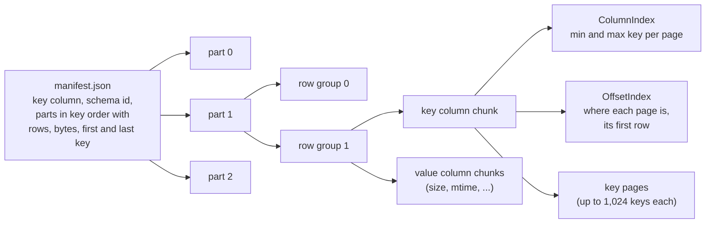
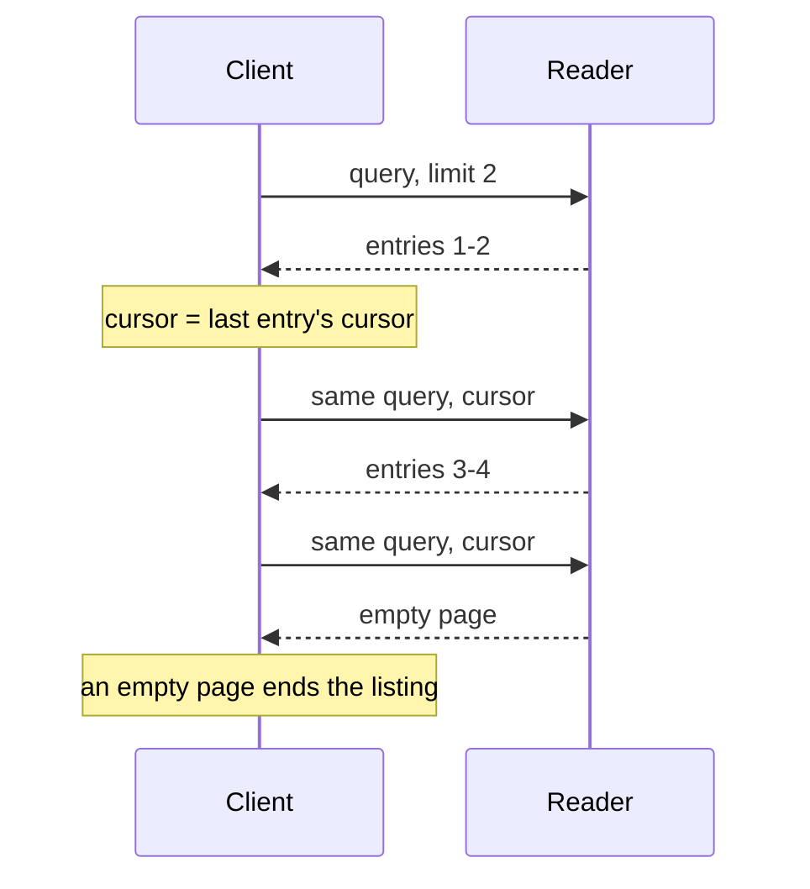
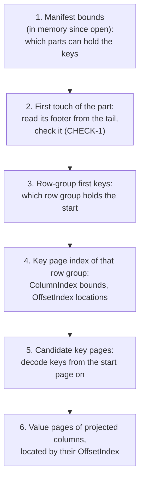
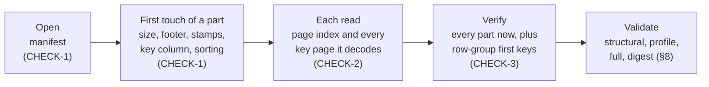

# Concepts

This page explains the model behind SeekParquet: what a dataset is, what a query returns, how a reader finds
rows, and what it checks. Every other page links here for its terms. The [specification](../spec/format-1.md)
is the normative text; this page cites its requirement IDs and does not restate its rules.

## A dataset in one picture

A **dataset** is a directory, or an object-store prefix, that holds a `manifest.json` and the Parquet files
the manifest lists. Those files are the dataset's **parts**. Every part is an ordinary Parquet file, so any
Parquet reader can read the rows.

The rules that make this a SeekParquet dataset and not just a set of Parquet files:

- One **key column**, a byte string named by the manifest, sorts every row of the dataset in unsigned byte
  order: within pages, across pages, row groups and parts ([KEY-3](../spec/format-1.md#key-3)).
- The parts are **key-disjoint** and listed in key order, each with its exact first and last key, row count
  and size ([PART-3](../spec/format-1.md#part-3), [PART-4](../spec/format-1.md#part-4)).
- Every row group's key column has a **page index**: a ColumnIndex (bounds per page) and an OffsetIndex
  (location and first row per page) ([RG-2](../spec/format-1.md#rg-2)).
- Each part's footer carries `seekparquet.*` **stamps** that repeat the manifest's version, schema id and key
  declaration ([STAMP-1](../spec/format-1.md#stamp-1)).
- The manifest is the **commit**: it is written last and atomically, and the parts it lists never change
  ([COMMIT-1](../spec/format-1.md#commit-1), [COMMIT-2](../spec/format-1.md#commit-2)). A dataset is an
  immutable snapshot.

Columns other than the key are yours: their names, types and meaning belong to the producer, identified by
the manifest's `schema_id` ([COL-1](../spec/format-1.md#col-1)). A part may lack a column that other parts
have ([COL-2](../spec/format-1.md#col-2)).

## Keys and order

A **key** is a non-empty byte string. Keys compare byte by byte as unsigned integers from 0 to 255, and a key
that is a proper prefix of another sorts first. Keys need not be UTF-8. This is the order of `bytes` in
Python, `bytes.Compare` in Go and `Arrays.compareUnsigned` in Java. It is not the order of a string
collation, a locale, or UTF-16 code units.

The manifest declares whether keys are **unique**. With **repeated keys**, consecutive rows with equal keys
form a **key group**. A key group keeps the order the producer wrote it in, may span pages and row groups,
and never spans parts ([KEY-7](../spec/format-1.md#key-7)). Each row has an **offset**: its zero-based
position in its key group, always 0 when keys are unique.

The **successor** of a prefix `p` is the least byte string greater than every key that begins with `p`. For
`logs/` it is `logs0`. A prefix of only `0xFF` bytes has no successor.

## Queries

The specification defines what a query returns, independent of how a reader finds it
([§6](../spec/format-1.md#6-queries)). Take a dataset with these keys:

| Key |
|---|
| `logs/2026/01/a.gz` |
| `logs/2026/01/b.gz` |
| `logs/2026/02/a.gz` |
| `logs/readme` |
| `photos/cat.jpg` |

| Query | Arguments | Result |
|---|---|---|
| **Range read** ([RANGE-1](../spec/format-1.md#range-1)) | start `logs/2026/01/b.gz` (inclusive), end `photos/` (exclusive) | rows `logs/2026/01/b.gz`, `logs/2026/02/a.gz`, `logs/readme` |
| **Prefix read** | prefix `logs/2026/` | rows `logs/2026/01/a.gz`, `logs/2026/01/b.gz`, `logs/2026/02/a.gz` |
| **Lookup** | key `logs/readme` | the key group of `logs/readme`: one row |
| **Delimited listing** ([LIST-2](../spec/format-1.md#list-2), [LIST-3](../spec/format-1.md#list-3)) | prefix `logs/`, delimiter `/` | common prefix `logs/2026/`, row `logs/readme` |

A range read returns rows in key order, at most a **result limit** of them. Its bounds include or exclude
whole key groups; the result limit may split one. A prefix read is a range read bounded by the prefix and its
successor. A lookup is a range read of exactly one key group.

A **delimited listing** works like listing an S3 bucket with a delimiter. Each key under the prefix becomes
either a **row entry**, or, when the rest of the key contains the delimiter, the **common prefix** up to and
including that delimiter. Common prefixes appear once each. A common prefix also carries its **exact row**
when a row is stored at exactly that key, so a folder and a folder object come back together
([LIST-8](../spec/format-1.md#list-8)).

Every query can **project** columns by name. Each projected column of each row is a value, a null, or
**absent** when the row's part does not have the column. Absent is not null.

## Pagination

A **cursor** marks where a page ended. A **row cursor** is a key and an offset; a **prefix cursor** is a
common prefix that a listing returned. Repeating the same query with the cursor of the last entry returns the
next page. The pages, joined, equal the unpaginated result exactly, with no gaps and no repeats
([PAGE-2](../spec/format-1.md#page-2)). This is exact because the dataset is immutable.

- A page may end inside a key group. The row cursor's offset resumes inside it.
- A prefix cursor skips every key under its common prefix, so the prefix is not returned again
  ([LIST-6](../spec/format-1.md#list-6)).
- A short page does not mean the end: stop on an empty page.
- A cursor applies to the query and dataset that produced it. Used elsewhere, it is a position, not an
  error: the reader compares keys and does not check that the position exists
  ([PAGE-1](../spec/format-1.md#page-1)).

A **cursor token** is a cursor written as one line of text, for an API that hands cursors to clients:
`spc1.r.<key>.<offset>` or `spc1.p.<prefix>` ([cursor token, version 1](../spec/cursor-token-1.md)). The Go
and Java readers read each other's tokens.

## How a read finds its rows

A reader with only the manifest can route a query to the parts that can hold its keys. Inside a part it uses
the page index to reach the first key page that can hold the start key. It decodes from there.

Each numbered step depends on the one before it, so on remote storage each is at least one more wait for a
response. A reader keeps what it learns: a **cold** read is the first operation on a freshly opened dataset
and does every step; a **warm** read repeats a similar operation on the same open dataset and reuses the
footers and page indexes it already loaded. How many requests each step takes depends on the implementation
and the storage, and is not part of the format.

A **tail read** fetches the end of a part, where Parquet keeps the footer, in one request. A **logical read**
is one byte range the reader asks its storage for; a **physical request** is what the storage sends over the
network for it, which may merge or split logical reads. A **round** is one set of requests that must finish
before the next can start.

## What is checked, and when

A reader checks what it reads. It does not certify what it skips ([§7](../spec/format-1.md#7-what-readers-check-and-when)).

| Stage | Checks | Does not show |
|---|---|---|
| Open | the manifest is valid and its version is supported | anything about the parts |
| First touch | a part exists, has the manifest's size and row count, a readable footer, matching stamps, a valid key column and `sorting_columns` | anything inside its pages |
| Read | the page index of each row group it reads; every key it decodes is in order and within its page's bounds | rows it does not decode ([CHECK-4](../spec/format-1.md#check-4)) |
| Verify (Go `Dataset.Verify`, Java `Dataset.verify`) | every part now, as first touch would; row-group first keys and each part's edge keys against the manifest | every row; digests |
| Validate (Go only) | every key and, at the full level, every value of every page, independently of the indexes; digests at the digest level | how the dataset was published ([VAL-3](../spec/format-1.md#val-3)) |

A **check** is what a read does as it goes. **Verify** is the explicit check of every part. **Validate** is
the separate procedure that reads everything. See [validating](guides/validating.md).

## Four kinds of error

| Kind | Meaning | Go | Java |
|---|---|---|---|
| **Refusal** | the data breaks the specification; it carries a stable [refusal code](reference/refusal-codes.md) | `*RefusalError` | `RefusalException` |
| **Unsupported** | the data is valid but uses a feature this reader does not implement | `*UnsupportedError` | `UnsupportedFeatureException` |
| **Limit** | the data or result exceeds a [limit](reference/limits.md) you set, or a capacity of the reader | `*LimitError` | `LimitExceededException` |
| **Environment** | storage failed, the request was cancelled, the dataset was closed, or the request was invalid | the storage's or context's error, `ErrClosed`, `ErrInvalidRequest` | `StorageException`, `CancellationException`, `IllegalStateException`, `IllegalArgumentException` |

Only a refusal says the data is wrong. [Troubleshooting](guides/troubleshooting.md) says what to do about each
code.

## Storage

A reader reads a dataset through a small storage interface: Go `Source`, which opens files by path, and Java
`DatasetStorage`, which reads the manifest and opens parts. A local directory is one implementation; an object
store is another that you write. Whatever the storage, a part, once opened, must return the bytes of one
object version for as long as it is open ([CHECK-6](../spec/format-1.md#check-6)).

> Pending: the guide to implementing a `Source` over an object store waits for the reader I/O branch
> (`claude/reader-io-scheduling`).

## Glossary

- **absent**: A projected column the row's part does not have. Not null ([COL-2](../spec/format-1.md#col-2)).
- **cache budget**: A memory bound that never fails an operation; past it the reader stops keeping what it loads. Compare [limit](#limit).
- **check**: What a read verifies as it goes: the manifest on open, a part on first touch, pages as they are decoded (§7).
- **cold**: The first operation on a freshly opened dataset, with nothing loaded yet.
- **common prefix**: A listing entry that stands for every key under it, up to and including the delimiter.
- **cursor**: Where a page ended: a row cursor (key and offset) or a prefix cursor (a common prefix).
- **cursor token**: A cursor as one line of text, `spc1.r.` or `spc1.p.`.
- **dataset**: A manifest and the parts it lists: one immutable snapshot.
- **exact row**: The row stored at exactly a common prefix's bytes, returned with the prefix ([LIST-8](../spec/format-1.md#list-8)).
- **first touch**: The first read that routes to a part; the part is checked then.
- **key**: A non-empty byte string in the key column, compared in unsigned byte order.
- **key group**: Consecutive rows with equal keys, when keys repeat.
- **key page index**: The page index of the key column: ColumnIndex and OffsetIndex.
- **limit**: A resource bound that fails the operation exceeding it. Not a refusal. See [limits](reference/limits.md).
- **list index**: An optional in-memory structure a reader can build to answer wide listings with fewer page reads. Not part of the format.
- **logical read**: One byte range the reader asks its storage for.
- **manifest**: `manifest.json`: the dataset's commit, listing its parts with exact bounds, rows and sizes.
- **offset**: A row's zero-based position in its key group.
- **page index**: Parquet's ColumnIndex (bounds per page) and OffsetIndex (location and first row per page).
- **part**: One Parquet file of a dataset, covering a key range disjoint from the others.
- **physical request**: What the storage sends over the network for one or more logical reads.
- **refusal**: The reader's report that the data breaks the specification, with a stable code.
- **result limit**: The most entries one query returns. Not a resource [limit](#limit).
- **round**: A set of requests that must complete before the next can start.
- **row entry**: A listing entry that is one row.
- **row group**: Parquet's horizontal slice of a part.
- **speculative read**: A read made before it is known to be needed, such as a tail read or listing read-ahead.
- **tail read**: One read of the end of a part, which holds its footer.
- **unsupported**: Valid data that uses a feature the reader does not implement.
- **validate**: The separate procedure that checks everything, at four levels (§8). Go only.
- **verify**: Check every part now ([CHECK-3](../spec/format-1.md#check-3)): Go `Dataset.Verify`, Java `Dataset.verify`.
- **warm**: An operation on a dataset that earlier operations already loaded footers and page indexes for.
