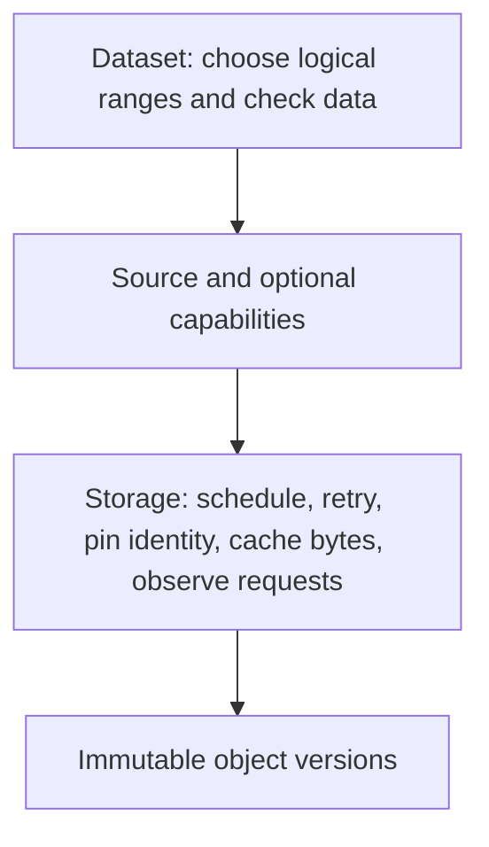

# Implement a storage Source

Supply a `Source` to `OpenDataset` when your data is outside a local directory or needs application storage policy.
Use `OpenDir` for the local-directory reader: it reads through an `os.Root`, so no path or symbolic link
reads outside the directory, and it reports a FIFO or device as missing instead of blocking on it.
The reader chooses logical ranges and checks metadata;
your Source executes reads, caches bytes, and observes physical requests.
Java storage has its own, smaller interface: see [implement Java storage](#implement-java-storage).



## Implement the minimum contract

Implement [`Source`](https://pkg.go.dev/github.com/varveio/seekparquet/go#Source) and return files implementing [`SourceFile`](https://pkg.go.dev/github.com/varveio/seekparquet/go#SourceFile).

| Method | Required behavior |
|---|---|
| `Source.Open(ctx, path)` | Open a root-relative slash-separated path; establish actual size and an immutable file view; honor cancellation when opening |
| `SourceFile.ReadAt(buf, off)` | Implement `io.ReaderAt`, including short-read errors; support concurrent calls over the same object version |
| `SourceFile.Size()` | Return a stable length for the handle's lifetime |
| `SourceFile.Close()` | Release the handle after the reader joins its reads |

The reader checks manifest paths against [PART-1](../../spec/format-1.md#part-1); your Source must still confine reads to its root.
Return an error wrapping `fs.ErrNotExist` for missing files.
Source calls and file reads must be concurrency-safe ([`Source`](https://pkg.go.dev/github.com/varveio/seekparquet/go#Source)).
Keep the Source usable until its datasets close. The dataset closes files it opened; the caller owns the Source.

Pin one object version for each open handle, including across retries and range batches
([CHECK-6](../../spec/format-1.md#check-6), [`SourceFile`](https://pkg.go.dev/github.com/varveio/seekparquet/go#SourceFile)).
Use a conditional read, version selector, or equivalent primitive to serve the pinned version or fail when it is unavailable.
When an established pin fails, return `ErrObjectChanged`; do not combine bytes from different versions.

## Open an in-memory dataset

This test loads a fixture into the repository's existing in-memory test store.
It uses `fakestore` and `fakeSource` from the reader's tests, not public library packages.
The snippet comes from `TestGuideMemorySource`; it is not published as a godoc example.
The imports are in [`go/example_reading_test.go`](../../go/example_reading_test.go).
The thin `Source` and file implementation is in
[`go/iobudget_fixture_test.go`](../../go/iobudget_fixture_test.go); the byte store is in
[`internal/testutil/fakestore`](../../go/internal/testutil/fakestore/fakestore.go).
Use those as contract examples when implementing your own Source.

**Go**

<!-- snippet: go/example_reading_test.go#TestGuideMemorySource -->
```go
ctx := context.Background()
objects := make(map[string]fakestore.Object)
err := filepath.WalkDir("../conformance/datasets/multipart", func(path string, entry os.DirEntry, err error) error {
	if err != nil {
		return err
	}
	if entry.IsDir() {
		return nil
	}
	name, err := filepath.Rel("../conformance/datasets/multipart", path)
	if err != nil {
		return err
	}
	data, err := os.ReadFile(path)
	if err != nil {
		return err
	}
	objects[filepath.ToSlash(name)] = fakestore.Object{Data: data}
	return nil
})
if err != nil {
	t.Fatal(err)
}
store := fakestore.New(objects, fakestore.Options{})
defer store.Close()
// fakeSource is the existing test-only Source implementation; see the guide.
d, err := seekparquet.OpenDataset(ctx, fakeSource{store}, seekparquet.OpenOptions{})
if err != nil {
	t.Fatal(err)
}
defer d.Close()
rows, err := d.Rows(ctx, seekparquet.Query{Limit: 1}, nil)
if err != nil {
	t.Fatal(err)
}
if len(rows) != 1 {
	t.Fatalf("got %d rows, want 1", len(rows))
}
if got := string(rows[0].Key); got != "README" {
	t.Fatalf("first key = %q, want README", got)
}
```
<!-- /snippet -->

## Carry cancellation to scalar reads

See [`ContextBinder`](https://pkg.go.dev/github.com/varveio/seekparquet/go#ContextBinder) for scalar cancellation and context propagation, and [`RangeReader`](https://pkg.go.dev/github.com/varveio/seekparquet/go#RangeReader) for batch context and capability discovery.

## Add optional capabilities

Each capability is independent; the reader falls back to `Open` and scalar `ReadAt` where needed.

| Capability | Opportunity | Required behavior and failure handling |
|---|---|---|
| [`SizedSource`](https://pkg.go.dev/github.com/varveio/seekparquet/go#SizedSource) | Avoid a separate size-discovery physical request on a part open | Treat manifest size as expected, not proven; establish identity and actual total size before a nonempty read succeeds |
| [`ManifestReader`](https://pkg.go.dev/github.com/varveio/seekparquet/go#ManifestReader) | Read the manifest with one whole-object physical request on the ordinary successful path | Bound accepted payload by `maxBytes`; return caller-owned complete bytes and an identity for those exact bytes |
| [`RangeReader`](https://pkg.go.dev/github.com/varveio/seekparquet/go#RangeReader) | Batch logical ranges for storage to merge, split, reorder, or deduplicate | Validate the whole batch before I/O; return each range's complete outcome; join work before returning |

### Open with an expected size

`OpenSized` returns a stable `Size()` equal to the expected length.
A response proving both object identity and actual total length can establish the pin.
Otherwise obtain matching metadata or fail ([`SizedSource`](https://pkg.go.dev/github.com/varveio/seekparquet/go#SizedSource)).
An initial observed-size disagreement returns `SizeMismatchError`.
A violation of an established pin returns `ErrObjectChanged`, rather than a size mismatch.
Zero-length reads establish neither identity nor size.

### Read the manifest whole

Check trustworthy lengths before allocating; for unknown lengths, consume at most `maxBytes+1` with checked arithmetic,
then report `ErrObjectTooLarge` on excess ([`ManifestReader`](https://pkg.go.dev/github.com/varveio/seekparquet/go#ManifestReader)).
An empty identity is allowed. Do not return truncated data as success or a mutable alias into your cache.
`Metadata.ManifestIdentity` is diagnostic; it is not proof of the parts' identities.

### Read ranges in a batch

Validate descriptor count, total buffer lengths, nonnegative offsets, and bounds against the file size.
Use [`MaxReadRanges`](https://pkg.go.dev/github.com/varveio/seekparquet/go#MaxReadRanges) and [`MaxReadBatchBytes`](https://pkg.go.dev/github.com/varveio/seekparquet/go#MaxReadBatchBytes) for the per-call bounds;
zero-length ranges through EOF require no I/O ([`RangeReader`](https://pkg.go.dev/github.com/varveio/seekparquet/go#RangeReader)).

The caller owns the buffers. Destination regions must not overlap; file ranges may overlap or repeat.
Do not retain buffers or descriptors after returning, including on cancellation.
See [`RangeReader`](https://pkg.go.dev/github.com/varveio/seekparquet/go#RangeReader) for the operation-context contract.

Return nil only when every buffer is completely valid.
A `BatchError.Errs` entry corresponds to its input range, not completion order; nil means that range succeeded.
Any other returned error invalidates every range ([`BatchError`](https://pkg.go.dev/github.com/varveio/seekparquet/go#BatchError), [`RangeReader`](https://pkg.go.dev/github.com/varveio/seekparquet/go#RangeReader)).
The reader consumes errors in semantic range order in its [storage I/O layer](../../go/storageio.go).
An unused speculative failure does not invalidate a successful demanded range;
see the [window implementation](../../go/windows.go#L243-L246) for speculative-failure handling.

## Return errors the reader can classify

| Storage outcome | Reader classification |
|---|---|
| Missing manifest (`fs.ErrNotExist`) | `no_manifest` at open |
| Missing part (`fs.ErrNotExist`) | `missing_part` refusal |
| Initial `SizeMismatchError` | `part_mismatch` refusal |
| Broken pin (`ErrObjectChanged`) | Environment error |
| Manifest beyond accepted payload (`ErrObjectTooLarge`) | `LimitError` naming `ManifestBytes` |
| Cancellation, transport errors, failed response validation | Environment error |
| Full scalar buffer with `io.EOF` only | Accepted by the full-read helper |
| Short scalar buffer or EOF inside a checked extent | Read failure; EOF truncation can report a data refusal |

See [manifest loading](../../go/dataset.go) and [source-error/full-read classification](../../go/storageio.go).
A full buffer accompanied by another error is not success; retain that error.
Panics from `ReadAt` and `ReadRanges` become environment errors containing the recovered value
([`Source`](https://pkg.go.dev/github.com/varveio/seekparquet/go#Source)). Avoid using panics for ordinary failures.

## Own caching, physical requests, and observations

Choose retry, connection, request concurrency, and byte-cache policy in your Source.
Keep cached bytes bound to the same immutable identity as uncached reads.
A storage-specific cache bypass should preserve identity, size checks, and error semantics.
See [`ContextBinder`](https://pkg.go.dev/github.com/varveio/seekparquet/go#ContextBinder) for propagating context values to storage policy.

See [`ReadStats`](https://pkg.go.dev/github.com/varveio/seekparquet/go#ReadStats) for counter scope and exclusions; instrument physical requests, wire bytes, retries, and cache hits at storage.
A `ReadRanges` call may produce several physical requests or none if storage serves cached bytes.
See [remote I/O](remote-io.md).

## Test your implementation

Test the storage contract before interpreting reader performance:

- Concurrent scalar reads, overlapping file ranges, independent contexts, and reads at EOF.
- Missing objects, initial size mismatch, replacement after pinning, and replacement during retries.
- Cancellation while queued, while reading, and while retrying; no work or buffer access after a batch returns.
- Mixed `BatchError` outcomes and full buffers accompanied by errors.
- Whole-manifest size bounds, caller-owned returned bytes, and absent identities.

Use the repository's [storage contract tests](../../go/storageio_test.go),
[storage fault tests](../../go/iobudget_fault_test.go), and
[capability implementation](../../go/iobudget_fixture_test.go) as examples.
These test helpers are internal; there is no public Source test kit.
Run the [conformance suite](../../conformance/README.md) through your reader integration using its
[protocol](../../conformance/protocol.md), then measure your actual physical requests separately.

## Account for reader windows

Scans and projected reads can fetch windows through your batched capability;
without it, the reader uses concurrent scalar reads under an internal limit.
See [`ReadPolicy`](https://pkg.go.dev/github.com/varveio/seekparquet/go#ReadPolicy) for window bounds and [operating](operating.md#account-for-per-operation-memory) for memory sizing.
Your Source still owns physical scheduling and byte caching.

## Implement Java storage

The Java reader reads through two interfaces in `io.varve.seekparquet.storage`, with no parquet-java type in
them. Pass a `DatasetStorage` to `Dataset.open(storage, options, cancellation)`.

| Interface | Required behavior |
|---|---|
| `DatasetStorage.readManifest(maxBytes, cancellation)` | Return the whole `manifest.json`; throw `NoSuchFileException` when there is none. It may stop after `maxBytes + 1` bytes, which the reader rejects as too large |
| `DatasetStorage.openPart(path, expectedSize, cancellation)` | Open one part by its manifest path (already checked against [PART-1](../../spec/format-1.md#part-1); do not decode or normalize it). `expectedSize` is the manifest's size, a hint, for example to fetch the footer with one suffix-range request |
| `PartSource.size()` | The stored object's actual size, which the reader compares with the manifest |
| `PartSource.read(position, length, cancellation)` | Positioned reads, safe for concurrent use. Every read returns bytes of the object version that was opened, or fails with `PartChangedException` |
| `PartSource.version()` | An optional pinned version, for diagnostics |

The caller owns the `DatasetStorage`; the reader never closes it, and it must stay usable until the dataset
closes, since a part is opened when a request first touches it. The reader closes every `PartSource` it
opened: a part refused by its check at once, the others when the dataset closes. A returned buffer's bytes
must stay unchanged for as long as the reader keeps it (a footer or page index until the dataset closes),
even after the source is closed; its position and limit are the reader's, so return a shared buffer as its own
duplicate or slice. Signal cancellation with `CancellationException` or a non-timeout
`InterruptedIOException`; a `SocketTimeoutException` stays a storage failure. Caching and request coalescing
belong in decorators of these interfaces. Java has no counterpart of Go's batched `RangeReader`: each range
is one `read`.

`ParquetJavaInterop` converts to and from parquet-java: `partSource(path, inputFile, version)` adapts an
existing `InputFile`, and `inputFile(partSource)` views a source as an `InputFile` whose streams do not close
the source.

`LocalStorage` is the only implementation in the module. It reads each part through one `FileChannel` with
positioned reads, resolves each part path one segment at a time from the root, refuses a symbolic link in any
segment, requires the part and `manifest.json` to be regular files, and detects a part that changes size or
is replaced. What it guarantees depends on the platform:

| | Linux, macOS (secure directory streams) | Windows (plain directory streams) |
|---|---|---|
| Lookup | relative to a pinned handle on each directory: no later replacement of a directory can redirect it | by path, each directory checked to be a real directory (no symbolic link, junction or other reparse point) and checked again before and after every open |
| Refused in a segment | symbolic links | symbolic links, junctions and other reparse points; `:` (drives, alternate data streams), `<>"\|?*`, a trailing dot or space, device names such as `NUL` or `COM1` |
| File identity, before and after each open | `fileKey` (device and inode) | size, modification and creation times, and the opened file's size |
| Reopen after an interrupt | through the same pinned handles | by path, with the directories and the file's identity checked again |
| A FIFO swapped in after the check | cannot hold a request: each open runs on its own thread | cannot occur: a named pipe cannot be a directory entry |

On Windows, a replacement made between two checks, or one made to match a file's size and times, can go
unseen: keep a dataset directory writable only by its producer. Files the JDK does not report as regular
(cloud-storage placeholders, for example) are refused. Other file systems without secure directory streams (a
zip file system, for example) take the Windows route.

On POSIX systems, whoever can write the dataset directory can replace a checked regular file with a FIFO
before it is opened, and Java cannot open a file without blocking on one. So each open of a part or of the
manifest runs on a new platform thread, through its own directory handle, and the request stops waiting when
cancelled. This costs a short-lived thread and a directory handle per part open, once per part per dataset.
An open that never returns strands its thread until the file is opened for writing or the process exits; after
64 stranded opens, a `LocalStorage` fails further opens with a storage error.
