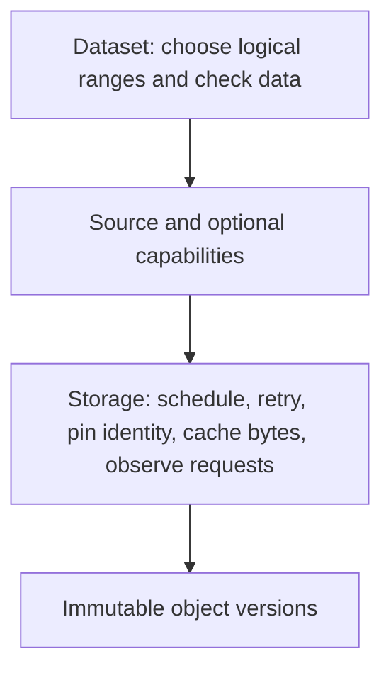

# Implement a storage Source

Supply a `Source` to `OpenDataset` when your data is outside a local directory or needs application storage policy.
Use `OpenDir` for the local-directory reader. The reader chooses logical ranges and checks metadata;
your Source executes reads, caches bytes, and observes physical requests.

> Pending: WP-L Java storage examples and the batched/sized SPI wait for Java API alignment (`claude/java-api-alignment`).

<!-- java: pending alignment -->



## Implement the minimum contract

Implement [`Source`](https://pkg.go.dev/github.com/varveio/seekparquet/go#Source) and return files implementing [`SourceFile`](https://pkg.go.dev/github.com/varveio/seekparquet/go#SourceFile).

| Method | Required behavior |
|---|---|
| `Source.Open(ctx, path)` | Open a root-relative slash-separated path; establish actual size and an immutable file view; honor cancellation when opening |
| `SourceFile.ReadAt(buf, off)` | Implement `io.ReaderAt`, including short-read errors; support concurrent calls over the same object version |
| `SourceFile.Size()` | Return a stable length for the handle's lifetime |
| `SourceFile.Close()` | Release the handle after the reader joins its reads |

The reader checks manifest paths against [PART-1](../../spec/format-1.md#part-1); your Source must still confine reads to its root.
Return an error wrapping `fs.ErrNotExist` for missing files.
Source calls and file reads must be concurrency-safe ([`Source`](https://pkg.go.dev/github.com/varveio/seekparquet/go#Source)).
Keep the Source usable until its datasets close. The dataset closes files it opened; the caller owns the Source.

Pin one object version for each open handle, including across retries and range batches
([CHECK-6](../../spec/format-1.md#check-6), [`SourceFile`](https://pkg.go.dev/github.com/varveio/seekparquet/go#SourceFile)).
Use a conditional read, version selector, or equivalent primitive to serve the pinned version or fail when it is unavailable.
When an established pin fails, return `ErrObjectChanged`; do not combine bytes from different versions.

## Open an in-memory dataset

This runnable example loads a fixture into the repository's existing in-memory test store.
It uses `fakestore` and `fakeSource` from the reader's tests, not public library packages.
The imports are in [`go/example_reading_test.go`](../../go/example_reading_test.go).
The thin `Source` and file implementation is in
[`go/iobudget_fixture_test.go`](../../go/iobudget_fixture_test.go); the byte store is in
[`internal/testutil/fakestore`](../../go/internal/testutil/fakestore/fakestore.go).
Use those as contract examples when implementing your own Source.

**Go**

<!-- snippet: go/example_reading_test.go#ExampleOpenDataset_memorySource -->
```go
ctx := context.Background()
objects := make(map[string]fakestore.Object)
err := filepath.WalkDir("../conformance/datasets/multipart", func(path string, entry os.DirEntry, err error) error {
	if err != nil {
		return err
	}
	if entry.IsDir() {
		return nil
	}
	name, err := filepath.Rel("../conformance/datasets/multipart", path)
	if err != nil {
		return err
	}
	data, err := os.ReadFile(path)
	if err != nil {
		return err
	}
	objects[filepath.ToSlash(name)] = fakestore.Object{Data: data}
	return nil
})
if err != nil {
	log.Fatal(err)
}
store := fakestore.New(objects, fakestore.Options{})
defer store.Close()
// fakeSource is the existing test-only Source implementation; see the guide.
d, err := seekparquet.OpenDataset(ctx, fakeSource{store}, seekparquet.OpenOptions{})
if err != nil {
	log.Fatal(err)
}
defer d.Close()
rows, err := d.Rows(ctx, seekparquet.Query{Limit: 1}, nil)
if err != nil {
	log.Fatal(err)
}
fmt.Println(string(rows[0].Key))
// Output:
// README
```
<!-- /snippet -->

## Carry cancellation to scalar reads

Implement [`ContextBinder`](https://pkg.go.dev/github.com/varveio/seekparquet/go#ContextBinder) when scalar reads can block on a connection, retry, or remote response.
`WithContext` returns an independent reader view; keep context out of shared mutable handle state.
Propagate the operation context's values to your storage instrumentation and cache policy too.
Without this capability, a plain `ReadAt` already in progress cannot be interrupted by the reader.
The original file's `RangeReader` capability is discovered before `ContextBinder` is applied
([`RangeReader`](https://pkg.go.dev/github.com/varveio/seekparquet/go#RangeReader)).

## Add optional capabilities

Each capability is independent; the reader falls back to `Open` and scalar `ReadAt` where needed.

| Capability | Opportunity | Required behavior and failure handling |
|---|---|---|
| [`SizedSource`](https://pkg.go.dev/github.com/varveio/seekparquet/go#SizedSource) | Avoid a separate size-discovery physical request on a part open | Treat manifest size as expected, not proven; establish identity and actual total size before a nonempty read succeeds |
| [`ManifestReader`](https://pkg.go.dev/github.com/varveio/seekparquet/go#ManifestReader) | Read the manifest with one whole-object physical request on the ordinary successful path | Bound accepted payload by `maxBytes`; return caller-owned complete bytes and an identity for those exact bytes |
| [`RangeReader`](https://pkg.go.dev/github.com/varveio/seekparquet/go#RangeReader) | Batch logical ranges for storage to merge, split, reorder, or deduplicate | Validate the whole batch before I/O; return each range's complete outcome; join work before returning |

### Open with an expected size

`OpenSized` returns a stable `Size()` equal to the expected length.
A response proving both object identity and actual total length can establish the pin.
Otherwise obtain matching metadata or fail ([`SizedSource`](https://pkg.go.dev/github.com/varveio/seekparquet/go#SizedSource)).
An initial observed-size disagreement returns `SizeMismatchError`.
A violation of an established pin returns `ErrObjectChanged`, rather than a size mismatch.
Zero-length reads establish neither identity nor size.

### Read the manifest whole

Check trustworthy lengths before allocating; for unknown lengths, consume at most `maxBytes+1` with checked arithmetic,
then report `ErrObjectTooLarge` on excess ([`ManifestReader`](https://pkg.go.dev/github.com/varveio/seekparquet/go#ManifestReader)).
An empty identity is allowed. Do not return truncated data as success or a mutable alias into your cache.
`Metadata.ManifestIdentity` is diagnostic; it is not proof of the parts' identities.

### Read ranges in a batch

Validate descriptor count, total buffer lengths, nonnegative offsets, and bounds against the file size.
Use [`MaxReadRanges`](https://pkg.go.dev/github.com/varveio/seekparquet/go#MaxReadRanges) and [`MaxReadBatchBytes`](https://pkg.go.dev/github.com/varveio/seekparquet/go#MaxReadBatchBytes) for the per-call bounds;
zero-length ranges through EOF require no I/O ([`RangeReader`](https://pkg.go.dev/github.com/varveio/seekparquet/go#RangeReader)).

The caller owns the buffers. Destination regions must not overlap; file ranges may overlap or repeat.
Do not retain buffers or descriptors after returning, including on cancellation.
The operation context governs waits, physical requests, and retries.

Return nil only when every buffer is completely valid.
A `BatchError.Errs` entry corresponds to its input range, not completion order; nil means that range succeeded.
Any other returned error invalidates every range ([`BatchError`](https://pkg.go.dev/github.com/varveio/seekparquet/go#BatchError), [`RangeReader`](https://pkg.go.dev/github.com/varveio/seekparquet/go#RangeReader)).
Consume errors in semantic range order; a failed unused speculative range does not invalidate a successful demanded range.
The reader handles that distinction in its [storage I/O layer](../../go/storageio.go).

## Return errors the reader can classify

| Storage outcome | Reader classification |
|---|---|
| Missing manifest (`fs.ErrNotExist`) | `no_manifest` at open |
| Missing part (`fs.ErrNotExist`) | `missing_part` refusal |
| Initial `SizeMismatchError` | `part_mismatch` refusal |
| Broken pin (`ErrObjectChanged`) | Environment error |
| Manifest beyond accepted payload (`ErrObjectTooLarge`) | `LimitError` naming `ManifestBytes` |
| Cancellation, transport errors, failed response validation | Environment error |
| Full scalar buffer with `io.EOF` only | Accepted by the full-read helper |
| Short scalar buffer or EOF inside a checked extent | Read failure; EOF truncation can report a data refusal |

See [manifest loading](../../go/dataset.go) and [source-error/full-read classification](../../go/storageio.go).
A full buffer accompanied by another error is not success; retain that error.
Panics from `ReadAt` and `ReadRanges` become environment errors containing the recovered value
([`Source`](https://pkg.go.dev/github.com/varveio/seekparquet/go#Source)). Avoid using panics for ordinary failures.

## Own caching, physical requests, and observations

Choose retry, connection, request concurrency, and byte-cache policy in your Source.
Keep cached bytes bound to the same immutable identity as uncached reads.
A storage-specific cache bypass should preserve identity, size checks, and error semantics.
Context values are one way to carry these choices through a `ContextBinder` view.

`ReadStats` counts logical part reads and reader work. It excludes manifest reads and does not count physical requests or wire bytes
([`ReadStats`](https://pkg.go.dev/github.com/varveio/seekparquet/go#ReadStats)). Instrument those at storage, including retries and cache hits.
A `ReadRanges` call may produce several physical requests or none if storage serves cached bytes.
See [remote I/O](remote-io.md).

## Test your implementation

Test the storage contract before interpreting reader performance:

- Concurrent scalar reads, overlapping file ranges, independent contexts, and reads at EOF.
- Missing objects, initial size mismatch, replacement after pinning, and replacement during retries.
- Cancellation while queued, while reading, and while retrying; no work or buffer access after a batch returns.
- Mixed `BatchError` outcomes and full buffers accompanied by errors.
- Whole-manifest size bounds, caller-owned returned bytes, and absent identities.

Use the repository's [storage contract tests](../../go/storageio_test.go),
[storage fault tests](../../go/iobudget_fault_test.go), and
[capability implementation](../../go/iobudget_fixture_test.go) as examples.
These test helpers are internal; there is no public Source test kit.
Run the [conformance suite](../../conformance/README.md) through your reader integration using its
[protocol](../../conformance/protocol.md), then measure your actual physical requests separately.

## Account for reader windows

Scans and projected reads can fetch windows through your batched capability;
without it, the reader uses concurrent scalar reads under an internal limit.
Window bounds apply to fetched, undecoded bytes per operation, not total dataset or process memory
([`ReadPolicy`](https://pkg.go.dev/github.com/varveio/seekparquet/go#ReadPolicy)). See [operating](operating.md#account-for-per-operation-memory).
Your Source still owns physical scheduling and byte caching.
